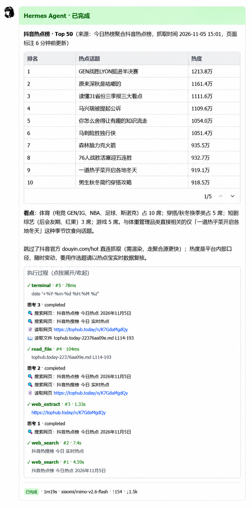

# Lark Card for Hermes（Hermes Agent飞书卡片回复）

[简体中文](#简体中文)（默认） · [English](#english)

---

把 Hermes 在飞书里的回复渲染成**一张持续更新的卡片**——状态头、工具时间线、可折叠思考面板、原生表格、token 统计、流式正文，一回合一条消息。

这是一个 Hermes **平台插件**：只覆写飞书 adapter 的 `send` / `edit_message` 出口，**不修改 Hermes 源码**。



*飞书实拍。Markdown 表格渲染成**原生 table 组件**——有表头底色、单元格边框、按列对齐——而不是一堆 `|` 竖线。底部 footer 是用时、模型和 token 用量。*

### 你能得到什么

- **状态头**：`⏳ 执行中` → `✅ 完成` / `⛔ 失败`，失败与中断各有独立终态。
- **工具时间线**：工具名、状态、耗时、脱敏后的参数预览；子代理同样上榜。`task` 模式下默认折叠。
- **思考面板**：推理进可折叠区域，不占正文。
- **原生表格**：Markdown 表格渲染成飞书 `table` 组件。
- **footer**：用时、模型、输入/输出 token、上下文用量。
- **流式正文**：边生成边更新，结束不留光标字符。更新做攒批合并并按飞书单卡 10 次/秒上限限速，另有 2s 周期整卡刷新，footer 计时不会冻住。
- **交互式 clarify**：选项渲染成真按钮，点了会真的回传；点过的卡冻结成静态回执（只留文字、不留控件），超时或被取代的提问会把按钮撤下。
- **回合外卡片不装忙**：启动通知、定时任务、斜杠命令的回复身后没有回合，渲染成已收尾的 notice 卡，而不是一张永远「⏳ 执行中」、计时还在涨的卡。
- **进程挂掉也不留转圈卡**：每个进行中的回合都有展示检查点；网关中途挂掉时，下次启动会把那张卡冻结成「已中断」（正文保留、不再转圈）。
- **命令卡**：斜杠命令的反馈用专门的卡——标题随命令、配色随结果（绿=完成 / 红=失败 / 蓝=进行中 / 橙=警告）。
- **命令中心**：`/commands` 菜单渲染成三层卡（概览 → 分类 → 详情），按钮能跳分类、返回、复投命令；`/status` 这类指标命令渲染成带指标列的结果卡。
- **切换命令**：`/card-preset`、`/card-activity` 随时切换阅读预设和实时工具调用显示（`full` / `summary` / `hidden`）。
- **私有依赖全部有本地兜底**：工具参数预览、`ask_choice` 菜单、命令注册表、内置 feishu 平台的准入声明——任一 Hermes 内部模块改名/重构时自动降级到本地实现（日志与 `/card-status` 可见），不会整片失效；lark-oapi 的 CARD 帧修补改为「哈希精确匹配 + 结构匹配」双层，SDK 补丁版不再整段放弃。
- **运维命令**：`/card-status`（版本、hooks、lark-oapi CARD 帧修补、投递计数/速率/错误码、点击去重、维护态、配置漂移）、`/card-doctor`（导出脱敏支持报告到 `~/.hermes/logs/lark-card-support-*.json`）、`/card-maintenance <on|off|status>`（升级窗口期跳过流式编辑，终稿照常投递）。
- **回合外通知**：不属于任何回合的通知（定时任务结果、自我改进回顾）独立成卡、footer 干净，不再继承上一回合的耗时/token。

### 为什么不会因为 Hermes 升级而挂

这是设计前提。已有的同类方案（HFC）**往 Hermes 源码里注入 hook** 并对源码做整文件字节校验，所以 Hermes 每发一个新版本就打不上补丁——它的 changelog 里直接写死要适配的 commit（如 `9b904dcc22c23...`）。

本项目反过来：

| | 源码注入方案 | 本项目 |
| --- | --- | --- |
| 改动 Hermes 源码 | 是 | **否** |
| 整文件字节校验 | 是（升级即失效） | 否 |
| 事件来源 | 注入 hook | 官方插件 hook（`VALID_HOOKS` 内的 11 个） |
| 接口面 | 大量私有符号 | 公开 `ctx.register_platform`；私有接缝集中在 `compat/`（清单见 `hermes plugins validate`） |
| 当前回合状态 | 进程级全局变量 | 显式每回合注册表（`turn_state.py`）：platform + session_key + chat/thread，以公开 `turn_id` 标识 |

渲染逻辑直接复用 HFC 的渲染栈（MIT，见 `hfc/`）。那部分代码在 5.0.9 → 5.0.13 之间**逐字节未变**——上游的维护成本全花在源码适配层，而本项目不需要那一层。

即便上游改了被依赖的私有函数，失败方式是**卡片退化成内置文本**（每条 `send` / `edit` 都有回落路径），而不是飞书不可用。

### 依赖

- 带插件系统和 `post_gateway_admission` 等 hooks 的 Hermes Agent **≥ 0.22**（0.23.x 上 `tests/run_all.py` 15/15 全绿）
- `lark-oapi` **1.6.8** —— 该版本的 `Client._handle_data_frame` 会静默丢弃 CARD 帧，导致**卡片按钮点击无效**。`hfc/feishu_ws_compat.py` 用 AST 精确匹配那段函数体并修掉；版本不符会自动放弃（`connect()` 成功后日志会写明是否修复）。

### 安装

```bash
git clone https://github.com/Keithin/lark-card-for-hermes.git ~/.hermes/plugins/lark-card-for-hermes
```

然后在**独立 shell** 里重启网关（不能在网关进程内部重启）：

```bash
hermes gateway restart
```

插件在网关启动时注册；改了插件代码必须重启才生效。

凭据沿用 Hermes 已有的飞书配置（环境变量或钥匙串），本插件不额外存凭据。

### 配置

`config.json`（插件根目录）是 `/card-preset`、`/card-activity` 写入的运行时状态，**不进 git**——手工创建或用命令生成。缺省时用 HFC 默认值；注意默认 `native_tables: false`（表格显示成管道符文本），要飞书原生表格请设 `"native_tables": true`。它会被 `hfc/config_rules.py` 校验，字段名全部沿用 HFC 的原有 schema：

```json
{
  "card": {
    "reading_preset": "task",
    "native_tables": true,
    "show_reasoning": true,
    "timeline_order": "newest_first",
    "timeline_expanded": false,
    "max_timeline_items": 12,
    "max_tool_result_chars": 600,
    "table_overflow_mode": "compact",
    "footer_fields": ["duration", "model", "input_tokens", "output_tokens", "context"]
  },
  "bindings": {
    "native_chats": []
  }
}
```

#### 阅读预设

`reading_preset` 四档，每档改变整张卡的布局：

| preset | 布局 | 思考进正文 | 时间线展开 | 隐藏已完成工具 |
| --- | --- | --- | --- | --- |
| `classic` | classic | ✓ | ✗ | ✗ |
| `focused` | classic | ✗ | ✗ | ✓ |
| `detailed` | classic | ✗ | ✓ | ✗ |
| `task` | task | ✗ | ✓ | ✓ |

> **注意**：显式写在 `card` 里的值会**覆盖**预设默认。切预设时要把冲突的旧键删掉，否则只生效一半。

#### 按 chat 选择卡片或原生文本

```json
"bindings": { "native_chats": ["oc_xxxxxxxx"] }
```

列进去的 chat 走飞书原生文本，其余仍走卡片。留空数组或不写该键 = 全部走卡片。

### 结构

```
__init__.py          # 插件入口：公开 ctx.register_platform + 11 个 hook + clarify 按钮卡
plugin.yaml          # 插件清单（插件 ID = catalog key = lark-card-for-hermes）
turn_state.py        # 显式每回合注册表（替代进程级「当前回合」全局变量）
compat/              # 内置 adapter 条目的薄兼容层（声明并测试支持范围）
tests/               # 15 项行为判据（隔离 HERMES_HOME），run_all.py 一键全跑
hfc/                 # HFC 渲染栈（MIT），原样复用
  bridge.py          #   ← 本项目新增：事件翻译层
  client.py          #   ← 本项目新增：最小 REST 通道
  render.py session.py cardkit.py card_timeline.py native_tables.py ...
```

`hfc/` 下的渲染与状态机代码来自 [Hermes Feishu Streaming Card](https://github.com/baileyh8/hermes-feishu-streaming-card)（MIT）。本项目新增的是接线层（`bridge.py` / `client.py`）、回合注册表（`turn_state.py`）、条目薄兼容层（`compat/`）、插件入口（`__init__.py`）与行为判据（`tests/`）。

### 已知限制

- 会话状态按 LRU 保留最近 64 个 chat，超出的 chat 再回来时卡片会从头开始。
- footer 不显示 token 速率（上游 `observed_rate` 未接线、已移除；需要时从 HFC ≥5.0.14 重新引入）。

### 许可

MIT。`hfc/` 目录保留上游版权声明，详见 `LICENSE`。

---

## English

> This is the English appendix; the default language of this document is Chinese.

Renders each Hermes reply in Feishu/Lark as **one live card** that updates in place — status header, tool timeline, collapsible reasoning panel, native tables, token footer, streaming body. One message per turn.

This is a Hermes **platform plugin**. It overrides only the Feishu adapter's outbound `send` / `edit_message` primitives and never touches Hermes source code.


*Screenshot taken from Feishu: a finished turn — status header, a Markdown table rendered as a **native table component** (header shading, cell borders, aligned columns, not a wall of `|` pipes), and the collapsible **execution panel** with every tool step. The footer shows duration, model and token usage.*

### What you get

- **Status header** — `⏳ running` → `✅ done` / `⛔ failed`, with distinct terminal states for failure and interruption.
- **Tool timeline** — tool name, status, duration, redacted argument preview. Subagents show up too. Collapsed by default in `task` mode.
- **Reasoning panel** — thinking goes into a collapsible block instead of the answer body.
- **Native tables** — Markdown tables become Feishu `table` components.
- **Footer** — duration, model, input/output tokens, context usage.
- **Streaming body** — updates as it generates, no leftover cursor glyph when it finishes. Updates are coalesced and throttled to Feishu's 10-mutations-per-second per-card limit, with a 2 s full refresh so the footer clock keeps moving.
- **Interactive clarify** — `clarify` options render as real buttons that send the answer back; a clicked card is frozen into a static receipt (text only, no controls), and expired or superseded prompts have their buttons withdrawn.
- **Honest out-of-turn cards** — startup/cron notifications and slash-command replies have no turn behind them, so they render as a notice card marked done instead of a card stuck on `⏳ running` with a growing clock.
- **Crash-safe cards** — each running turn keeps a display checkpoint. If the gateway dies mid-turn, the next start freezes that card into a finished "已中断" card (content kept, no spinner) instead of leaving it spinning forever.
- **Command cards** — slash-command feedback gets its own card: title by command, colour by outcome (green done / red failed / blue running / orange warning).
- **Command center** — the `/commands` menu renders as a three-level card (overview → category → detail) whose buttons navigate categories, go back, or re-dispatch a command; metric commands such as `/status` render as result cards with metric columns.
- **Switch commands** — `/card-preset` and `/card-activity` change the reading preset and the live tool-call display (`full` / `summary` / `hidden`) on the fly.
- **Every private dependency has a local fallback** — tool-argument preview, `ask_choice` menus, the command registry and the bundled feishu platform declaration all degrade to in-tree implementations when a Hermes internal moves (visible in the log and in `/card-status`); the lark-oapi CARD-frame repair is now two-tier (exact body hash, then structural match) so SDK patch releases are no longer rejected wholesale.
- **Ops commands** — `/card-status` (version, hooks, lark-oapi CARD-frame repair, delivery counters/rates/error codes, click dedupe, maintenance state, config-drift), `/card-doctor` (writes a redacted support report to `~/.hermes/logs/lark-card-support-*.json`), `/card-maintenance <on|off|status>` (skip streaming edits during a Hermes upgrade window; final answers still delivered).
- **Out-of-turn notices** — notices that belong to no turn (cron results, self-improvement reviews) get their own card and a clean footer; they no longer inherit the previous turn's duration/tokens.

### Why it does not break when Hermes upgrades

This is the design premise. The existing alternative (HFC) **injects hooks into Hermes source** and verifies those files by whole-file byte hash, so every new Hermes release invalidates the patch — its own changelog pins the exact commit it targets (e.g. `9b904dcc22c23...`).

This project does the opposite:

| | Source-injection approach | This project |
| --- | --- | --- |
| Modifies Hermes source | Yes | **No** |
| Whole-file byte verification | Yes (breaks on upgrade) | No |
| Event source | Injected hooks | Official plugin hooks (11 of them, all in `VALID_HOOKS`) |
| Surface area | Many private symbols | Public `ctx.register_platform`; private seams confined to `compat/` (see `hermes plugins validate` output) |
| Current-turn state | Process-wide globals | Explicit per-turn registry (`turn_state.py`): platform + session_key + chat/thread, keyed by public `turn_id` |

The rendering logic reuses HFC's rendering stack (MIT, see `hfc/`). That code was **byte-identical** across HFC 5.0.9 → 5.0.13 — upstream's maintenance cost all goes into the source-adaptation layer, which this project does not need.

Even if upstream changes a private function we depend on, the failure mode is **the card degrading to bundled text** (every `send` / `edit` has a fallback path), not Feishu going down.

### Requirements

- Hermes Agent **≥ 0.22** with a plugin system and hooks such as `post_gateway_admission` (tested on 0.23.x; `tests/run_all.py` 15/15 green)
- `lark-oapi` **1.6.8** — that version's `Client._handle_data_frame` silently drops CARD frames, which makes **card button clicks do nothing**. `hfc/feishu_ws_compat.py` matches that function body by AST hash and repairs it; on a version mismatch it declines automatically (`connect()` logs whether the repair was applied).

### Install

```bash
git clone https://github.com/Keithin/lark-card-for-hermes.git ~/.hermes/plugins/lark-card-for-hermes
```

Then restart the gateway **from a separate shell** (you cannot restart it from inside the gateway process):

```bash
hermes gateway restart
```

The plugin registers at gateway startup; editing plugin code requires a restart to take effect.

Credentials reuse Hermes' existing Feishu configuration (environment variables or keychain). This plugin stores none of its own.

### Configuration

`config.json` (plugin root) is runtime state written by `/card-preset` and `/card-activity`, so it is **not tracked in git** — create it by hand or via those commands. Without it the HFC defaults apply; note the default is `native_tables: false` (markdown tables render as pipe text), so set `"native_tables": true` for Feishu-native tables. It is validated by `hfc/config_rules.py`. Every key follows HFC's existing schema:

```json
{
  "card": {
    "reading_preset": "task",
    "native_tables": true,
    "show_reasoning": true,
    "timeline_order": "newest_first",
    "timeline_expanded": false,
    "max_timeline_items": 12,
    "max_tool_result_chars": 600,
    "table_overflow_mode": "compact",
    "footer_fields": ["duration", "model", "input_tokens", "output_tokens", "context"]
  },
  "bindings": {
    "native_chats": []
  }
}
```

#### Reading presets

`reading_preset` has four levels, each changing the whole card layout:

| preset | layout | thinking into body | timeline expanded | hide finished tools |
| --- | --- | --- | --- | --- |
| `classic` | classic | ✓ | ✗ | ✗ |
| `focused` | classic | ✗ | ✗ | ✓ |
| `detailed` | classic | ✗ | ✓ | ✗ |
| `task` | task | ✗ | ✓ | ✓ |

> **Note:** values written explicitly under `card` **override** the preset defaults. When switching presets, delete the conflicting old keys — otherwise only half the preset applies.

#### Per-chat: card or native text

```json
"bindings": { "native_chats": ["oc_xxxxxxxx"] }
```

Listed chats get native Feishu text; everything else keeps cards. An empty array or a missing key means all chats use cards.

### Layout

```
__init__.py          # plugin entry: public ctx.register_platform + 11 hooks + clarify button cards
plugin.yaml          # manifest (plugin ID = catalog key = lark-card-for-hermes)
turn_state.py        # explicit per-turn registry (replaces process-wide current-turn globals)
compat/              # thin layer over the bundled adapter's registry entry (tested support range)
tests/               # 13 behavior checks (isolated HERMES_HOME), run_all.py runs them all
hfc/                 # HFC rendering stack (MIT), used as-is
  bridge.py          #   ← new here: event translation layer
  client.py          #   ← new here: minimal REST channel
  render.py session.py cardkit.py card_timeline.py native_tables.py ...
```

The rendering and state-machine code under `hfc/` comes from [Hermes Feishu Streaming Card](https://github.com/baileyh8/hermes-feishu-streaming-card) (MIT). The code added by this project is the wiring layer (`bridge.py` / `client.py`), the turn registry (`turn_state.py`), the thin registry-compat layer (`compat/`), the entry point (`__init__.py`) and the behavior checks (`tests/`).

### Known limitations

- Session state is kept for the most recent 64 chats (LRU). A chat that falls off the list starts its card from scratch when it returns.
- The footer never shows a token rate (upstream `observed_rate` was dropped as unwired; re-add from HFC ≥5.0.14 if a rate field is ever wanted).

### License

MIT. The `hfc/` directory retains its upstream copyright notice — see `LICENSE`.

---
