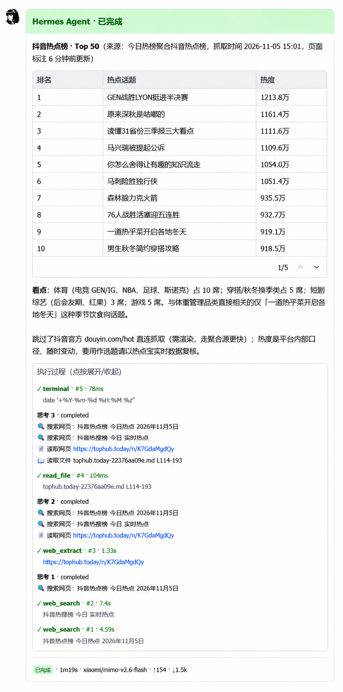

# Lark Card for Hermes（Hermes Agent飞书卡片回复）

**English** · [简体中文](#简体中文)

---

## English

Renders each Hermes reply in Feishu/Lark as **one live card** that updates in place — status header, tool timeline, collapsible reasoning panel, native tables, token footer, streaming body. One message per turn.

This is a Hermes **platform plugin**. It subclasses the bundled Feishu adapter, overriding `send`, `edit_message`, `send_final_ledgered` and related card/clarify lifecycle methods without editing Hermes source files.



*Screenshot taken from Feishu: a finished turn — status header, a Markdown table rendered as a **native table component** (header shading, cell borders, aligned columns, not a wall of `|` pipes), and the collapsible **execution panel** with every tool step. The footer shows duration, model and token usage.*

### What you get

- **Status header** — `⏳ running` → `✅ done` / `⛔ failed`, with distinct terminal states for failure and interruption.
- **Tool timeline** — tool name, status, duration, redacted argument preview. Subagents show up too. Collapsed by default in `task` mode.
- **Reasoning panel** — thinking goes into a collapsible block instead of the answer body.
- **Native tables** — Markdown tables become Feishu `table` components.
- **Footer** — duration, model, input/output tokens, context usage.
- **Streaming body** — updates as it generates, no leftover cursor glyph when it finishes. Updates are coalesced and throttled to Feishu's 10-mutations-per-second per-card limit, with a 2 s full refresh so the footer clock keeps moving.
- **Interactive clarify** — `clarify` options render as real buttons that send the answer back; a clicked card is frozen into a static receipt (text only, no controls), and expired or superseded prompts have their buttons withdrawn.
- **Honest out-of-turn cards** — startup/cron notifications and slash-command replies have no turn behind them, so they render as a notice card marked done instead of a card stuck on `⏳ running` with a growing clock.
- **Crash-safe cards** — each running turn keeps a display checkpoint. If the gateway dies mid-turn, the next start freezes that card into a finished "已中断" card (content kept, no spinner) instead of leaving it spinning forever.
- **Command cards** — slash-command feedback gets its own card: title by command, colour by outcome (green done / red failed / blue running / orange warning).
- **Command center** — the `/commands` menu renders as a three-level card (overview → category → detail) whose buttons navigate categories, go back, or re-dispatch a command; metric commands such as `/status` render as result cards with metric columns.
- **Switch commands** — `/card-preset` and `/card-activity` change the reading preset and the live tool-call display (`full` / `summary` / `hidden`) on the fly.

### Upgrade compatibility and its limits

Avoiding source patches reduces upgrade coupling; it does not remove it. HFC's source-injection approach verifies patched files by whole-file byte hash, so upstream file changes can invalidate its patches.

This project does the opposite:

| | Source-injection approach | This project |
| --- | --- | --- |
| Modifies Hermes source | Yes | **No** |
| Whole-file byte verification | Yes (breaks on upgrade) | No |
| Event source | Injected hooks | Official plugin hooks (11 of them, all in `VALID_HOOKS`) |
| Surface area | Many private symbols | Public `ctx.register_platform` and hooks; internal bundled-adapter registration/loading in `compat/`, plus adapter overrides including `send_final_ledgered` in `__init__.py` |
| Current-turn state | Process-wide globals | Explicit per-turn registry (`turn_state.py`): platform + session_key + chat/thread, keyed by public `turn_id` |

The rendering logic reuses and adapts HFC's rendering stack (MIT, see `hfc/`). Hermes adapter internals, hook payloads and the installed `lark-oapi` SDK remain runtime compatibility dependencies.

Some card send/edit failures have bundled-text fallback paths. Import, registration, method-signature, lifecycle or SDK changes can fail before those paths run; fallback is not a guarantee of delivery or compatibility.

### Requirements

- The manifest declares Hermes Agent **≥ 0.22**, with a plugin system and hooks such as `post_gateway_admission`; this is not proof that every matching version works. The CI matrix targets official **v0.23.3 and v0.23.4** on Python **3.14**; compatibility evidence is the successful run for the exact plugin commit, not this range.
- A real `lark-oapi` runtime: CI uses real dependencies from `tests/requirements.txt` and tests SDK **1.6.8 / 1.7.5**. The optional WebSocket repair in `hfc/feishu_ws_compat.py` targets the known **1.6.8** `Client._handle_data_frame` body by AST hash and declines mismatches. Neither that repair nor offline CI proves live button delivery on every SDK version.

### v1.8.0 release and upgrade gate

- Authoritative final answers and notices are not classified as tool progress by their text. Unknown preview text is kept; a missing tool label table does not justify deleting prose.
- Tools, reasoning and usage attach only to an exact turn/session or the task-local gateway route. A sole active Feishu chat is not identity proof; unowned observations are omitted.
- Finished titles follow answer content. Counts and duration appear in **bold in the footer**, not in the title.
- Run the same command against a clean official checkout before adding a Hermes version to the tested matrix:

```bash
python -m venv .venv-test
.venv-test/bin/python -m pip install -r tests/requirements.txt lark-oapi==1.7.5
LCH_HERMES_DIR=/path/to/clean/hermes-agent .venv-test/bin/python tests/run_all.py
```

The runner copies the plugin into a temporary profile with fixture configuration: it does not test against your live config/state. CI checks official Hermes v0.23.3/v0.23.4 with both SDKs. These are offline adapter/registration/identity/rendering tests using fake Feishu transport, **not** a full Hermes install, model run or live Feishu visual/button certification. New versions must pass the gate rather than inherit a blanket compatibility claim. Release only from the exact commit whose compatibility matrix has passed; tag `v1.8.0` must match the manifest version and local checkout. Loading new code still requires a gateway restart.

### Install

```bash
git clone https://github.com/Keithin/lark-card-for-hermes.git ~/.hermes/plugins/lark-card-for-hermes
```

Then restart the gateway **from a separate shell** (you cannot restart it from inside the gateway process):

```bash
hermes gateway restart
```

The plugin registers at gateway startup; editing plugin code requires a restart to take effect.

Credentials reuse Hermes' existing Feishu configuration (environment variables or keychain). This plugin stores none of its own.

### Configuration

`config.json` (plugin root) is runtime state written by `/card-preset` and `/card-activity`, so it is **not tracked in git** — create it by hand or via those commands. Without it the HFC defaults apply; note the default is `native_tables: false` (markdown tables render as pipe text), so set `"native_tables": true` for Feishu-native tables. It is validated by `hfc/config_rules.py`. Every key follows HFC's existing schema:

```json
{
  "card": {
    "reading_preset": "task",
    "native_tables": true,
    "show_reasoning": true,
    "timeline_order": "newest_first",
    "timeline_expanded": false,
    "max_timeline_items": 12,
    "max_tool_result_chars": 600,
    "table_overflow_mode": "compact",
    "footer_fields": ["duration", "model", "input_tokens", "output_tokens", "context"]
  },
  "bindings": {
    "native_chats": []
  }
}
```

#### Reading presets

`reading_preset` has four levels, each changing the whole card layout:

| preset | layout | thinking into body | timeline expanded | hide finished tools |
| --- | --- | --- | --- | --- |
| `classic` | classic | ✓ | ✗ | ✗ |
| `focused` | classic | ✗ | ✗ | ✓ |
| `detailed` | classic | ✗ | ✓ | ✗ |
| `task` | task | ✗ | ✓ | ✓ |

> **Note:** values written explicitly under `card` **override** the preset defaults. When switching presets, delete the conflicting old keys — otherwise only half the preset applies.

#### Per-chat: card or native text

```json
"bindings": { "native_chats": ["oc_xxxxxxxx"] }
```

Listed chats get native Feishu text; everything else keeps cards. An empty array or a missing key means all chats use cards.

### Layout

```
__init__.py          # plugin entry: public ctx.register_platform + 11 hooks + clarify button cards
plugin.yaml          # manifest (plugin ID = catalog key = lark-card-for-hermes)
turn_state.py        # explicit per-turn registry (replaces process-wide current-turn globals)
compat/              # thin layer over the bundled adapter's registry entry (tested support range)
tests/               # offline behavior checks (isolated HERMES_HOME), run_all.py discovers check_*.py
hfc/                 # HFC-derived rendering stack (MIT), with local adaptations
  bridge.py          #   ← new here: event translation layer
  client.py          #   ← new here: minimal REST channel
  render.py session.py cardkit.py card_timeline.py native_tables.py ...
```

The rendering and state-machine code under `hfc/` comes from [Hermes Feishu Streaming Card](https://github.com/baileyh8/hermes-feishu-streaming-card) (MIT). The code added by this project is the wiring layer (`bridge.py` / `client.py`), the turn registry (`turn_state.py`), the thin registry-compat layer (`compat/`), the entry point (`__init__.py`) and the behavior checks (`tests/`).

### Known limitations

- Session state is kept for the most recent 64 chats (LRU). A chat that falls off the list starts its card from scratch when it returns.
- The footer never shows a token rate (upstream `observed_rate` was dropped as unwired; re-add from HFC ≥5.0.14 if a rate field is ever wanted).

### License

MIT. The `hfc/` directory retains its upstream copyright notice — see `LICENSE`.

---

## 简体中文

把 Hermes 在飞书里的回复渲染成**一张持续更新的卡片**——状态头、工具时间线、可折叠思考面板、原生表格、token 统计、流式正文，一回合一条消息。

这是一个 Hermes **平台插件**：继承内置飞书 adapter，覆写 `send`、`edit_message`、`send_final_ledgered` 及相关卡片/clarify 生命周期方法，**不修改 Hermes 源码文件**。


*飞书实拍。Markdown 表格渲染成**原生 table 组件**——有表头底色、单元格边框、按列对齐——而不是一堆 `|` 竖线。底部 footer 是用时、模型和 token 用量。*

### 你能得到什么

- **状态头**：`⏳ 执行中` → `✅ 完成` / `⛔ 失败`，失败与中断各有独立终态。
- **工具时间线**：工具名、状态、耗时、脱敏后的参数预览；子代理同样上榜。`task` 模式下默认折叠。
- **思考面板**：推理进可折叠区域，不占正文。
- **原生表格**：Markdown 表格渲染成飞书 `table` 组件。
- **footer**：用时、模型、输入/输出 token、上下文用量。
- **流式正文**：边生成边更新，结束不留光标字符。更新做攒批合并并按飞书单卡 10 次/秒上限限速，另有 2s 周期整卡刷新，footer 计时不会冻住。
- **交互式 clarify**：选项渲染成真按钮，点了会真的回传；点过的卡冻结成静态回执（只留文字、不留控件），超时或被取代的提问会把按钮撤下。
- **回合外卡片不装忙**：启动通知、定时任务、斜杠命令的回复身后没有回合，渲染成已收尾的 notice 卡，而不是一张永远「⏳ 执行中」、计时还在涨的卡。
- **进程挂掉也不留转圈卡**：每个进行中的回合都有展示检查点；网关中途挂掉时，下次启动会把那张卡冻结成「已中断」（正文保留、不再转圈）。
- **命令卡**：斜杠命令的反馈用专门的卡——标题随命令、配色随结果（绿=完成 / 红=失败 / 蓝=进行中 / 橙=警告）。
- **命令中心**：`/commands` 菜单渲染成三层卡（概览 → 分类 → 详情），按钮能跳分类、返回、复投命令；`/status` 这类指标命令渲染成带指标列的结果卡。
- **切换命令**：`/card-preset`、`/card-activity` 随时切换阅读预设和实时工具调用显示（`full` / `summary` / `hidden`）。

### 升级兼容性与边界

不打源码补丁能减少升级耦合，但不能消除兼容风险。HFC 的源码注入方案对补丁目标做整文件字节校验，上游文件变化可能使补丁失效。

本项目反过来：

| | 源码注入方案 | 本项目 |
| --- | --- | --- |
| 改动 Hermes 源码 | 是 | **否** |
| 整文件字节校验 | 是（升级即失效） | 否 |
| 事件来源 | 注入 hook | 官方插件 hook（`VALID_HOOKS` 内的 11 个） |
| 接口面 | 大量私有符号 | 公开 `ctx.register_platform` 与 hooks；`compat/` 依赖内置 adapter 注册/加载机制，`__init__.py` 另覆写 `send_final_ledgered` 等内部接口 |
| 当前回合状态 | 进程级全局变量 | 显式每回合注册表（`turn_state.py`）：platform + session_key + chat/thread，以公开 `turn_id` 标识 |

渲染逻辑复用并调整了 HFC 渲染栈（MIT，见 `hfc/`）。Hermes adapter 内部实现、hook 参数和已安装的 `lark-oapi` SDK 都是运行时兼容性依赖。

部分卡片发送/编辑错误有内置文本回落路径；导入、注册、方法签名、生命周期或 SDK 变化可能在进入这些路径前就失败。不能保证所有故障都可回落，也不能据此保证消息送达。

### 依赖

- 清单声明 Hermes Agent **≥ 0.22**，需带插件系统和 `post_gateway_admission` 等 hooks；此下限不代表范围内各版本均兼容。CI 矩阵目标是官方 **v0.23.3、v0.23.4** 和 Python **3.14**，兼容证据以对应插件 commit 的成功运行记录为准。
- 真实的 `lark-oapi` 运行时：CI 使用 `tests/requirements.txt` 中的真实依赖，分别测试 SDK **1.6.8 / 1.7.5**。`hfc/feishu_ws_compat.py` 的可选 WebSocket 修复以 AST 哈希匹配已知 **1.6.8** 的 `Client._handle_data_frame`，不匹配则放弃；该修复和离线 CI 均不能证明所有 SDK 版本的真实按钮投递可用。

### v1.8.0 与升级门槛

- 最终答复和普通通知不再按文本外形判作工具进度；缺少工具标签时，保留无法确认的预览，不能删正文。
- 工具、推理和用量只绑定精确 turn/session 或任务上下文路由；唯一活动飞书回合不是归属证明，未知事件不展示。
- 完成卡标题随正文变化；工具次数与耗时只在**尾部加粗**，不再占标题。
- 新 Hermes 版本先在干净官方源码上执行上方命令，再加入兼容矩阵。测试复制插件到临时 Profile，使用固定测试配置，不读写实际用户配置和检查点。
- CI 覆盖官方 v0.23.3/v0.23.4 × SDK 1.6.8/1.7.5。它是使用真实依赖、假飞书传输的离线适配器/注册/归属/渲染测试，不等于完整 Hermes 安装、模型或飞书客户端视觉与按钮验收。
- 只有精确提交的矩阵通过后才发布；tag、manifest 版本和本地 checkout 必须一致。新代码加载仍需重启网关，不能把源码同步当成运行态已加载。

### 安装

```bash
git clone https://github.com/Keithin/lark-card-for-hermes.git ~/.hermes/plugins/lark-card-for-hermes
```

然后在**独立 shell** 里重启网关（不能在网关进程内部重启）：

```bash
hermes gateway restart
```

插件在网关启动时注册；改了插件代码必须重启才生效。

凭据沿用 Hermes 已有的飞书配置（环境变量或钥匙串），本插件不额外存凭据。

### 配置

`config.json`（插件根目录）是 `/card-preset`、`/card-activity` 写入的运行时状态，**不进 git**——手工创建或用命令生成。缺省时用 HFC 默认值；注意默认 `native_tables: false`（表格显示成管道符文本），要飞书原生表格请设 `"native_tables": true`。它会被 `hfc/config_rules.py` 校验，字段名全部沿用 HFC 的原有 schema：

```json
{
  "card": {
    "reading_preset": "task",
    "native_tables": true,
    "show_reasoning": true,
    "timeline_order": "newest_first",
    "timeline_expanded": false,
    "max_timeline_items": 12,
    "max_tool_result_chars": 600,
    "table_overflow_mode": "compact",
    "footer_fields": ["duration", "model", "input_tokens", "output_tokens", "context"]
  },
  "bindings": {
    "native_chats": []
  }
}
```

#### 阅读预设

`reading_preset` 四档，每档改变整张卡的布局：

| preset | 布局 | 思考进正文 | 时间线展开 | 隐藏已完成工具 |
| --- | --- | --- | --- | --- |
| `classic` | classic | ✓ | ✗ | ✗ |
| `focused` | classic | ✗ | ✗ | ✓ |
| `detailed` | classic | ✗ | ✓ | ✗ |
| `task` | task | ✗ | ✓ | ✓ |

> **注意**：显式写在 `card` 里的值会**覆盖**预设默认。切预设时要把冲突的旧键删掉，否则只生效一半。

#### 按 chat 选择卡片或原生文本

```json
"bindings": { "native_chats": ["oc_xxxxxxxx"] }
```

列进去的 chat 走飞书原生文本，其余仍走卡片。留空数组或不写该键 = 全部走卡片。

### 结构

```
__init__.py          # 插件入口：公开 ctx.register_platform + 11 个 hook + clarify 按钮卡
plugin.yaml          # 插件清单（插件 ID = catalog key = lark-card-for-hermes）
turn_state.py        # 显式每回合注册表（替代进程级「当前回合」全局变量）
compat/              # 内置 adapter 条目的薄兼容层（声明并测试支持范围）
tests/               # 离线行为判据（隔离 HERMES_HOME），run_all.py 自动发现 check_*.py
hfc/                 # 基于 HFC 的渲染栈（MIT），含本地调整
  bridge.py          #   ← 本项目新增：事件翻译层
  client.py          #   ← 本项目新增：最小 REST 通道
  render.py session.py cardkit.py card_timeline.py native_tables.py ...
```

`hfc/` 下的渲染与状态机代码来自 [Hermes Feishu Streaming Card](https://github.com/baileyh8/hermes-feishu-streaming-card)（MIT）。本项目新增的是接线层（`bridge.py` / `client.py`）、回合注册表（`turn_state.py`）、条目薄兼容层（`compat/`）、插件入口（`__init__.py`）与行为判据（`tests/`）。

### 已知限制

- 会话状态按 LRU 保留最近 64 个 chat，超出的 chat 再回来时卡片会从头开始。
- footer 不显示 token 速率（上游 `observed_rate` 未接线、已移除；需要时从 HFC ≥5.0.14 重新引入）。

### 许可

MIT。`hfc/` 目录保留上游版权声明，详见 `LICENSE`。
